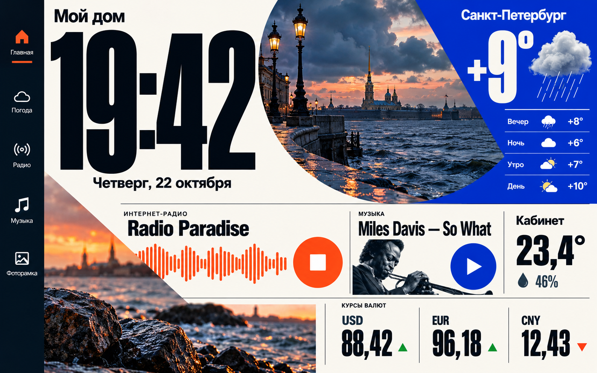

# nol-my-homecenter — Home Media Centre

Домашняя настенная панель для старого Android-планшета: нативное приложение на Java и собственный сервер на PHP + MySQL. Основное устройство разработки — ASUS Transformer Pad TF303CL / K014 с Android 4.4.2. Текущая версия клиента — **0.12.35**.



*На изображении дизайн-концепт. Реальный интерфейс работает с вашими данными и фотографиями.*

В приложении доступны погода, интернет-радио, каталог MP3 на сервере, финансы, комнатные BLE-датчики и фоторамка. Есть классический дизайн и «Неоплакат», светлая/тёмная палитры, общие часы, управление звуком и выбор ранее сопряжённых Bluetooth-колонок. Серверная веб-панель управляет настройками планшетов, источниками, каталогами и фотографиями.

Радио воспроизводится напрямую с адреса станции. MP3 передаются с сервера потоком с поддержкой Range: вся библиотека на планшет не копируется. Погода и последние сводки кэшируются; предусмотрен прямой погодный fallback при недоступности сервера. Датчики Xiaomi LYWSD03MMC читаются планшетом по BLE.

## Начало работы

### Установка с ИИ-агентом

Можно поручить установку своему агенту. Дайте ему ссылку на репозиторий и, например, такой запрос:

```text
Склонируй https://github.com/alexnolmann/nol-my-homecenter.git,
прочитай AGENTS.md и помоги установить сервер, веб-панель и Android-приложение.
Сначала предложи выбрать уровень объяснений 1 / 2 / 3.
Выполни доступные шаги сам, проведи меня через необходимые действия
и проверь, что приложение действительно работает с моим сервером.
```

[AGENTS.md — руководство для агента](AGENTS.md) задаёт сценарий от выбора окружения до сопряжения и проверки устройства, с тремя уровнями объяснений и разбором типовых проблем. Возможности агента зависят от доступа к вашему ПК; скрытый ввод пароля, подтверждение на планшете и другие физические действия могут потребовать вашего участия.

### Самостоятельная установка

1. Подготовьте PHP 8.4 с нужными расширениями и MySQL 8.4; установите Composer-зависимости.
2. Создайте собственную локальную конфигурацию и ключ шифрования, примените миграции, выполните первичную инициализацию сервера и создайте администратора.
3. Настройте веб-сервер с корнем `server/public_html`, запустите процесс `maintenance`.
4. Соберите Android-приложение, создайте город и код подключения в веб-панели, затем сопрягите планшет.

Подробные команды: [установка](docs/getting-started.md), [OSPanel](docs/deployment/os-panel.md), [сборка и тесты](docs/development.md).

## Структура

| Каталог | Содержимое |
| --- | --- |
| `android/app` | Основное приложение, JVM-тесты и debug-диагностика |
| `android/probe` | Отдельный инструмент проверки совместимости устройства |
| `server/private/app` | PHP-код вне корня сайта; это часть открытого исходного кода |
| `server/private/migrations` | Схема базы и миграции |
| `server/public_html` | Единственный корень веб-сайта |
| `server/tests` | Серверные проверки, включая отдельную тестовую MySQL |
| `contracts` | Контракт API и обезличенные тестовые ответы |
| `deploy` | OSPanel, Windows Nginx и контейнерные/Linux-шаблоны |
| `tools` | Установка, сборка, проверка APK и публикационного состава |
| `docs` | Актуальные инструкции и описание устройства проекта |

Все рабочие пароли, сертификаты, ключи, базы, загруженные фото, логи, APK и SDK создаются локально и исключены из Git. Серверный каталог с названием `private` означает «вне webroot», а не закрытый репозиторий.

## Статус и ограничения

Проект проверялся на одном старом планшете; совместимость с другими устройствами требует проверки. Для переключения A2DP на Android 4.4 используются возможности конкретной прошивки. Интеграция с Яндексом и управление умным домом пока не реализованы. Длительный суточный прогон остаётся отдельной незавершённой проверкой. Linux/PHP-FPM и контейнерные шаблоны требуют проверки на целевом хосте.

HTTP поддерживается для домашней сети только с явным разрешением на сервере; пароль и токены при этом передаются без шифрования. Для доступа через недоверенную сеть используйте HTTPS. Не выставляйте установку с локальными настройками разработки прямо в интернет.

Автоматические GitHub Actions выключены; workflow запускается вручную. Публичный репозиторий имеет отдельную начальную историю без частных отчётов разработки.

## Лицензия

Собственный код проекта распространяется под [MIT](LICENSE). Шрифты, Gradle Wrapper, публичный корневой сертификат и зависимости сохраняют свои условия: [THIRD_PARTY_NOTICES.md](THIRD_PARTY_NOTICES.md). Использование погодных данных, котировок и радиопотоков регулируется также условиями их поставщиков.

Публичный Git-адрес: [alexnolmann/nol-my-homecenter](https://github.com/alexnolmann/nol-my-homecenter).
